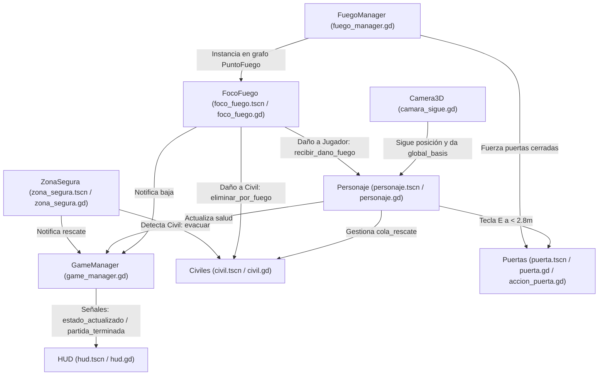

# Guía Técnica y de Presentación Universitaria — Panic Route 3D

> **Proyecto:** Panic Route 3D  
> **Motor:** Godot Engine 4.7 (`GL Compatibility` · Motor físico `Jolt Physics`)  
> **Asignatura:** Diseño y Desarrollo de Videojuegos (Ingeniería de Software)  
> **Escena Principal:** `res://escenas/main.tscn` (`Panic Route/escenas/main.tscn`)

---

## 1. Desarrollo de las Mecánicas del Videojuego

A continuación se documentan las **8 mecánicas reales** implementadas y funcionando en el proyecto.

---

### 1.1. Movimiento del Rescatista (Jugador) Relativo a la Cámara
* **Propósito:** Permitir al jugador desplazarse por las oficinas y pasillos en 3D con controles intuitivos (`W, A, S, D` o flechas) alineados con el ángulo de la vista cenital/isométrica.
* **Desde la perspectiva del jugador:** Al presionar `W` el personaje avanza hacia el norte de la pantalla, rota automáticamente su cuerpo mirando hacia donde camina y alterna entre su animación de quieto (`idle`) y caminar (`walk`).
* **Dónde se encuentra:**
  * Escena: `Panic Route/escenas/personaje.tscn`
  * Script: `Panic Route/scripts/personaje.gd`
* **Explicación técnica:**
  * El nodo raíz es un `CharacterBody3D` en la **capa de física 2 (`Jugador`)** con máscara hacia la **capa 1 (`Entorno`)**, perteneciente al grupo `"jugador"`.
  * En `_physics_process(delta)`, aplica gravedad (`get_gravity() * delta`), lee el vector 2D de entrada con `Input.get_vector("move_left", "move_right", "move_up", "move_down")` y lo multiplica por la matriz de orientación de la cámara (`camara.global_basis * entrada`) anulando el eje `Y` y normalizando el resultado (`direction.normalized()`).
  * Calcula `velocity.x` y `velocity.z` usando `speed = 3.5`, un `multiplicador` y un vector `empuje` (usado cuando el fuego lo golpea), orienta el modelo con `Basis.looking_at(direction)`, controla el `$Modelo/AnimationPlayer` (`"walk"` / `"idle"`) y ejecuta colisiones con `move_and_slide()`.
* **Explicación para dummies:**
  * Imagina que manejas un personaje con control remoto visto desde arriba: si empujas la palanca hacia arriba, el juego mira hacia dónde apunta la cámara para que "arriba" siempre sea hacia el fondo de tu pantalla, gira al muñeco en esa dirección y activa su animación de caminar.
* **Interacción con otras mecánicas:**
  * Al acercarse a los civiles activa su área de recogida; gestiona el arreglo `cola_rescate` para formar la fila de civiles; interactúa con puertas al pulsar `E` y recibe daño/empuje si toca un foco de fuego.

---

### 1.2. Cámara de Seguimiento Suavizado con Límites
* **Propósito:** Mantener al jugador siempre enfocado desde una perspectiva elevada táctica sin salirse de los bordes del edificio.
* **Desde la perspectiva del jugador:** La cámara sigue al personaje con un movimiento suave (sin tirones bruscos) y se detiene al llegar a los muros exteriores del mapa.
* **Dónde se encuentra:**
  * Nodo `Camera3D` dentro de `Panic Route/escenas/main.tscn`
  * Script: `Panic Route/scripts/camara_sigue.gd`
* **Explicación técnica:**
  * Extiende `Camera3D` y activa `top_level = true` en `_ready()` para independizar su transformación de cualquier padre, orientándose una sola vez con `look_at_from_position()` usando un offset fijo `distancia = Vector3(0, 14, 5)`.
  * En `_physics_process(delta)`, toma `objetivo.global_position`, restringe (`clamp`) las coordenadas `X` y `Z` entre `limite_min = Vector2(-17, -12)` y `limite_max = Vector2(17, 12)` y aplica interpolación lineal `global_position.lerp(destino, suavizado * delta)` con `suavizado = 4.0`.
* **Explicación para dummies:**
  * Es como un dron que vuela a 14 metros de altura unido al jugador por un resorte elástico: cuando el jugador se mueve, el dron lo sigue suavemente, pero tiene una "cerca invisible" para no enfocar fuera del edificio.
* **Interacción con otras mecánicas:**
  * Le entrega su `global_basis` a `personaje.gd` para calcular la dirección de movimiento.

---

### 1.3. Rescate de Civiles, Fila en Cadena y Navegación Inteligente
* **Propósito:** Permitir que el jugador recoja múltiples civiles atrapados en distintas oficinas y los escolte en una fila ordenada que rodea muebles y paredes sin bloquear el paso del jugador.
* **Desde la perspectiva del jugador:** Los civiles inician quietos con un indicador `[ ! ]` sobre la cabeza. Basta acercarse a ellos para recogerlos: el `[ ! ]` desaparece y cada civil se forma detrás del último de la fila, siguiendo al jugador hasta la salida.
* **Dónde se encuentra:**
  * Escena: `Panic Route/escenas/civil.tscn`
  * Scripts: `Panic Route/scripts/civil.gd` y funciones de cola en `Panic Route/scripts/personaje.gd`
* **Explicación técnica:**
  * **Capas de colisión desacopladas:** `Civil` está en la **capa 3 (`valor 4`)** con `collision_mask = 1` (`Entorno`). Esto hace que tanto el jugador como los civiles choquen contra muros y muebles, pero **no choquen físicamente entre sí**, evitando encerronas en pasillos.
  * **Máquina de estados (`enum Estado`):** `ESPERANDO`, `SIGUIENDO`, `EVACUADO`, `ELIMINADO`.
  * **Recogida por `Area3D`:** El nodo hijo `ZonaRecogida` (`SphereShape3D` de radio `2.34 m`, `collision_mask = 2`) detecta la señal `body_entered` del grupo `"jugador"` y llama a `recoger(jugador)`.
  * **Fila en cadena (`cola_rescate`):** `personaje.gd` mantiene `cola_rescate: Array[Node3D]`. El método `obtener_ultimo_en_fila(civil)` asigna al jugador como `objetivo` del primer civil recogido, al primer civil como `objetivo` del segundo, al segundo como `objetivo` del tercero, etc. Si un civil sale de la fila (`salir_de_fila()`), re-enlaza automáticamente a los que venían detrás.
  * **Navegación, separación y anti-atasco (`civil.gd`):**
    * Mantiene `distancia_parada = 1.15 m` respecto a su líder y aplica `_fuerza_separacion()` (`radio_separacion = 0.7 m`) respecto al grupo `"civiles"` para no superponerse.
    * Si la distancia al líder es `> 3.5 m`, consulta `NavigationAgent3D` sobre la malla `NavigationRegion3D` (`get_next_path_position()`) y acelera un `30%` (`rapidez * 1.3`).
    * Incluye `_deslizar_obstaculo()` (proyección vectorial sobre `get_wall_normal()`) y un temporizador `_tiempo_atascado`: si se traba contra un mueble por más de `0.45 s`, desactiva temporalmente `collision_mask` durante `0.45 s` para destrabarse y reincorporarse a la fila.
* **Explicación para dummies:**
  * Funciona como un "trencito humano": el primer civil sigue al jugador, el segundo sigue al primero y el tercero al segundo. Tienen un GPS (`NavigationAgent3D`) con el plano de los muebles para rodearlos, mantienen un metro de distancia para no amontonarse y, si alguno se engancha con la esquina de un sofá, se desliza automáticamente para no quedarse atrás.
* **Interacción con otras mecánicas:**
  * Al entrar en `ZonaSegura` se evacuan (`evacuar()`); al tocar `FocoFuego` mueren (`eliminar_por_fuego()`); ambos eventos actualizan `GameManager` y reordenan la fila del jugador.

---

### 1.4. Puertas Abatibles con Bisagra e Interacción por Tecla `E`
* **Propósito:** Controlar el acceso entre habitaciones y pasillos, funcionando además como barreras cortafuegos que retrasan el avance del incendio.
* **Desde la perspectiva del jugador:** Todas las puertas inician cerradas. Al acercarse a menos de `2.8 m` de cualquier puerta y presionar `E`, la hoja gira `90°` sobre sus bisagras en `0.45 s` permitiendo el paso; al presionar `E` de nuevo, se cierra.
* **Dónde se encuentra:**
  * Escena: `Panic Route/puerta.tscn` (acompañada visualmente del marco `Panic Route/entrada.tscn`)
  * Scripts: `Panic Route/puerta.gd` y `Panic Route/accion_puerta.gd`
* **Explicación técnica:**
  * `puerta.tscn` es un `StaticBody3D` en el grupo `"puertas"` con la malla `CHAHIN_DOOR.obj` desplazada `0.823 m` respecto al pivote para que el eje `Y` del nodo raíz actúe como bisagra.
  * `accion_puerta.gd` es un nodo hijo con máquina de estados (`LISTA`, `ACTIVA`, `RECARGA`, con `recarga = 0.35 s`). En `puede()`, localiza al jugador (`get_first_node_in_group("jugador")`), calcula la distancia al centro real de la hoja (`pj.to_global(Vector3(0, 0, 0.85))`) y verifica que sea `< 2.8 m` y que `en_movimiento` sea `false`.
  * `puerta.gd` ejecuta `alternar()`: invierte el booleano `abierta`, desactiva `$CollisionShape3D.disabled = true` al abrirse para no bloquear el paso durante el giro, e interpola `rotation:y` hasta `rot_inicial_y + deg_to_rad(90.0)` mediante un `Tween` de `0.45 s`.
* **Explicación para dummies:**
  * Cada puerta tiene un sensor de proximidad: si estás cerca y aprietas la tecla `E`, un motor gira la puerta `90 grados` como una bisagra real y apaga su bloqueo físico para que tú y tu fila de civiles pasen libremente.
* **Interacción con otras mecánicas:**
  * Mientras una puerta está cerrada (`abierta == false`), el algoritmo de fuego (`fuego_manager.gd`) la detecta en su camino y tiene que forzar su apertura antes de propagarse al otro lado.

---

### 1.5. Propagación Inteligente del Fuego (Grafo Multi-Ruta y Cortafuegos)
* **Propósito:** Crear la amenaza ambiental dinámica que reduce progresivamente las rutas seguras y obliga al jugador a tomar decisiones rápidas de rescate.
* **Desde la perspectiva del jugador:** El incendio comienza en la cocina central a los `2 s`. Cada `4.8 s` el fuego se expande hacia los pasillos y oficinas (a veces por dos rutas a la vez), forzando puertas cerradas y mostrando primero un aviso de humo y brasas parpadeantes durante `2 s` antes de que estallen las llamas.
* **Dónde se encuentra:**
  * Nodo `FuegoManager` y sus 14 hijos `Punto_*` en `Panic Route/escenas/main.tscn`
  * Scripts: `Panic Route/scripts/fuego_manager.gd` y `Panic Route/scripts/punto_fuego.gd`
* **Explicación técnica:**
  * **Grafo dirigido de nodos (`punto_fuego.gd`):** Cada punto es un `Marker3D` con `@export var vecinos: Array[NodePath]` (conexiones válidas por pasillos y puertas, sin atravesar muros) y un flag `@export var es_corredor_sur: bool`.
  * **Algoritmo de expansión (`fuego_manager.gd`):**
    1. Tras `retraso_inicial = 2.0 s`, enciende `Punto_Cocina`.
    2. Cada `intervalo_propagacion = 4.8 s`, determina si expande `1` o `2` focos según `probabilidad_doble_ruta = 0.55`.
    3. Recorre los vecinos no encendidos de los nodos activos y usa `_buscar_puerta_cerrada_entre(origen, destino)` (con `Geometry2D.get_closest_point_to_segment()` a distancia `<= 1.8 m`) para separar destinos en `opciones_libres` y `opciones_puerta`.
    4. **Protección temprana de ruta crítica:** Durante los primeros `tiempo_proteger_corredor_sur = 28.0 s`, filtra los nodos con `es_corredor_sur = true` mientras existan oficinas por quemar, garantizando que el jugador no sea encerrado en ambos corredores al inicio.
    5. **Ruptura de puertas cortafuegos:** Si un camino está bloqueado por una puerta cerrada, acumula golpes en `_presion_puertas`; al alcanzar `resistencia_puerta_cerrada = 1`, invoca `puerta.alternar()` para abrirla por presión térmica e instancia el nuevo foco del otro lado.
    6. **Garantía anti-bloqueo (`_consumir_civil_aislado_si_existe`):** Si ya se encendieron `>= 12` focos del mapa y aún queda algún civil sin recoger, expande un foco hasta su posición para que la partida nunca quede estancada.
* **Explicación para dummies:**
  * El mapa tiene una red invisible de 14 puntos conectados como paradas de metro que empiezan en la cocina. Cada 5 segundos el fuego elige la siguiente parada conectada; si encuentra una puerta cerrada, la empuja y la abre, y además respeta una regla de juego limpio: durante el primer medio minuto quema primero las oficinas del norte para dejarte al menos un pasillo de escape vivo.
* **Interacción con otras mecánicas:**
  * Instancia `foco_fuego.tscn`, interactúa con las puertas del grupo `"puertas"` y determina qué rutas siguen abiertas para el jugador y los civiles.

---

### 1.6. Foco de Fuego: Pre-aviso, Partículas Multicapa, Obstáculo de Navegación y Daño
* **Propósito:** Representar visualmente el incendio con humo, llamas y chispas, dar una ventana de reacción antes de quemar, desviar la navegación de los civiles y aplicar daño al contacto.
* **Desde la perspectiva del jugador:** Primero aparece una brasa parpadeante con humo durante `2 s` (se puede cruzar sin daño). Luego surgen las llamas: si un civil las toca, muere al instante; si el jugador las toca, pierde `1` corazón de salud y sale empujado hacia atrás.
* **Dónde se encuentra:**
  * Escena: `Panic Route/escenas/foco_fuego.tscn`
  * Script: `Panic Route/scripts/foco_fuego.gd`
* **Explicación técnica:**
  * **Fase de pre-aviso (`tiempo_preaviso = 2.0 s`):** Inicia con `activo = false`, `ParticulasHumo.emitting = true`, `ParticulasLlamas.emitting = false` y parpadeo de `Base` y `OmniLight3D`.
  * **Activación (`_activar_fuego()`):** Activa `activo = true`, enciende las 3 capas de `CPUParticles3D` (`ParticulasLlamas` con `blend_mode = ADD` y `GradienteLlama`, `ParticulasHumo` con `GradienteHumo` y `ParticulasChispas`), activa `NavigationObstacle3D.avoidance_enabled = true` (`radius = 1.5 m`) y verifica cuerpos superpuestos en `ZonaPeligro` (`Area3D` con `collision_mask = 6`, que cubre capas 2 `Jugador` y 3 `Civiles`).
  * **Efecto al contacto (`_on_body_entered`):**
    * Si `body.is_in_group("civiles")` → llama a `body.eliminar_por_fuego()` y `GameManager.registrar_baja()`.
    * Si `body.is_in_group("jugador")` → llama a `body.recibir_dano_fuego(global_position)`, que resta `1` de `salud`, activa `1.2 s` de invulnerabilidad (`_invulnerable`) y aplica un vector `empuje` de `6.0 m/s` en dirección opuesta al fuego.
* **Explicación para dummies:**
  * Cada fuego tiene dos fases: primero "avisa" echando humo 2 segundos y luego prende la llama. Cuando prende, hace tres cosas: ilumina de naranja la habitación, le avisa al GPS de los civiles que ahí hay peligro y quema a quien lo pise (a los civiles los elimina y al jugador lo empuja hacia atrás quitándole una vida).

---

### 1.7. Zona Segura de Evacuación (`EXIT`)
* **Propósito:** Servir como punto de extracción donde los civiles que vienen en la fila del jugador quedan a salvo y suman al objetivo de victoria.
* **Desde la perspectiva del jugador:** Es la plataforma verde brillante con el letrero `EXIT ➔` en el extremo derecho del mapa. Al pasar por ella con la fila de civiles, cada civil que pisa la zona verde desaparece a salvo y sube el contador de `Rescatados`.
* **Dónde se encuentra:**
  * Escena: `Panic Route/escenas/zona_segura.tscn`
  * Script: `Panic Route/scripts/zona_segura.gd`
* **Explicación técnica:**
  * Es un `Area3D` con `collision_layer = 0` y `collision_mask = 4` (solo detecta la capa 3: `Civiles`).
  * Al dispararse `body_entered`, comprueba `body.is_in_group("civiles")` e invoca `body.evacuar()`.
  * `evacuar()` cambia el estado del civil a `EVACUADO`, llama a `jugador.salir_de_fila(self)` para que los civiles detrás en la cola se re-enlacen sin romper la fila, destruye el nodo con `queue_free()` y notifica a `GameManager.registrar_rescate()`.
* **Explicación para dummies:**
  * Es la meta verde de salida: tiene un detector exclusivo para civiles. Cada vez que un civil de tu fila pisa la alfombra verde, queda rescatado, sale del mapa y suma un punto en el marcador.

---

### 1.8. Gestión de Partida (Victoria, Derrota, Pausa Táctica) y HUD
* **Propósito:** Centralizar las reglas del juego (conteo de civiles, límite del 20% de bajas, salud del rescatista, cronómetro y pausa con `ESPACIO`) y mostrarlas en tiempo real en pantalla.
* **Desde la perspectiva del jugador:** Arriba a la izquierda ve `Rescatados: X / 7`, `Bajas: X`, `Salud: ♥ ♥ ♥` y `Tiempo: MM:SS`. Con `ESPACIO` pausa la partida; si salva a los civiles gana (`¡VICTORIA!`), y si mueren más del 20% (2 o más de 7 civiles) o pierde sus 3 corazones, pierde (`DERROTA`) con opción de reiniciar.
* **Dónde se encuentra:**
  * Escena UI: `Panic Route/escenas/hud.tscn`
  * Scripts: `Panic Route/scripts/game_manager.gd` y `Panic Route/scripts/hud.gd`
* **Explicación técnica:**
  *Ambos nodos configuran `process_mode = Node.PROCESS_MODE_ALWAYS` para seguir respondiendo a teclado y botones cuando `get_tree().paused = true`.
  * `GameManager` pertenece al grupo `"game_manager"`, cuenta dinámicamente en `_ready()` el total de nodos en `"civiles"` (`total_civiles = 7`) y emite 3 señales desacopladas (`estado_actualizado`, `pausa_cambiada`, `partida_terminada`) a las que se suscribe `hud.gd`.
  * En `_verificar_fin()` aplica la regla matemática del documento conceptual:
    * **Derrota por bajas:** `float(eliminados) / float(total_civiles) > 0.2` (con 7 civiles, 1 baja = `14.2%` permitido; 2 bajas = `28.5%` → derrota inmediata).
    * **Derrota por salud:** `salud_jugador <= 0`.
    * **Victoria:** `rescatados + eliminados >= total_civiles` manteniendo las bajas `<= 20%`.
* **Explicación para dummies:**
  * `GameManager` es el árbitro del partido y `HUD` es el marcador en pantalla. El árbitro cuenta cuántos civiles hay al empezar, lleva el reloj y revisa dos reglas: que no pierdas tus 3 vidas y que no muera más del 20% de la gente. En cuanto se cumple la meta o pierdes, congela el juego y muestra la pantalla final con el botón de reiniciar.

---

## 2. Creación y Diseño de los Objetos del Juego

Los objetos del juego se dividen en **tres categorías** según su función técnica:

### A. Objetos con Funcionalidad e Interacción Programada

| Objeto | Archivo / Escena | Origen Visual | Cómo se creó e incorporó | Comportamiento Programado |
| :--- | :--- | :--- | :--- | :--- |
| **Rescatista (Jugador)** | `Panic Route/escenas/personaje.tscn` | Recurso externo `.glb`: `personaje/character-male-a.glb` (Kenney Mini Characters, CC0) + `Textures/colormap.png` | `CharacterBody3D` con `CapsuleShape3D` (`r=0.35, h=1.75`) y modelo escalado a `2.6` con `AnimationPlayer`. | Movimiento relativo a cámara, animaciones `idle`/`walk`, gestión de `cola_rescate`, 3 puntos de salud y retroceso ante fuego. |
| **Civil (NPC)** | `Panic Route/escenas/civil.tscn` | Recurso externo `.glb`: `personaje/character-male-d.glb` (Kenney, CC0) + `Label3D` nativo `[ ! ]` | `CharacterBody3D` (`r=0.26`), `NavigationAgent3D`, `Area3D` (`ZonaRecogida`) y `Label3D` con `billboard = 1`. | Espera con `[ ! ]` visible; al acercarse el jugador oculta `[ ! ]`, se une a la fila, navega esquivando muebles y se evacua o muere en el fuego. |
| **Puerta Interactiva** | `Panic Route/puerta.tscn` | Recurso externo `.obj`: `Models/,,,/CHAHIN_DOOR.obj` con `StandardMaterial3D` morado oscuro | `StaticBody3D` en grupo `"puertas"` con pivote en el borde para rotar como bisagra y nodo hijo `AccionPuerta`. | Se abre/cierra girando `90°` con `E` (`puerta.gd`), desactiva su colisión al abrirse y frena al fuego cuando está cerrada. |
| **Foco de Fuego** | `Panic Route/escenas/foco_fuego.tscn` | Creado desde cero en Godot con `CylinderMesh` (brasas) + 3 sistemas `CPUParticles3D` + `OmniLight3D` | Combina partículas aditivas para llamas (gradiente amarillo-naranja-rojo), partículas alfa para humo oscuro, chispas, `NavigationObstacle3D` y `Area3D`. | Pre-aviso de 2 s con humo, luego activa llamas, parpadeo de luz, desvío de NPCs y daño letal a civiles / daño con empuje al jugador. |
| **Zona Segura (`EXIT`)** | `Panic Route/escenas/zona_segura.tscn` | Creado desde cero en Godot con `BoxMesh` emisivo verde (`#06D6A0`), `Label3D` (`EXIT ➔`) y `OmniLight3D` | `Area3D` (`4.5 × 4.0 m`) ubicada en la salida este con máscara exclusiva para civiles (`collision_mask = 4`). | Detecta la llegada de civiles en la fila, los evacua del nivel y suma puntos de rescate en `GameManager`. |

---

### B. Mobiliario con Colisión Física Estática (Obstáculos de Navegación)
Estos objetos usan `StaticBody3D` (capa 1 `Entorno`) y están dentro de `NavigationRegion3D/Muebles` en `escenas/main.tscn`, por lo que bloquean el paso físico y son rodeados por los civiles:

| Objeto | Archivo / Escena | Origen Visual (Malla 3D) | Ubicación y Función en el Mapa |
| :--- | :--- | :--- | :--- |
| **Marco de Puerta** | `Panic Route/entrada.tscn` | Externo `.fbx`: `Models/,,,/wall-doorway-square.fbx` | Enmarca las 12 puertas del mapa con 2 `CollisionShape3D` laterales para las jambas. |
| **Escritorio Simple** | `Panic Route/escritorio1.tscn` | Externo `.obj`: `Models/OBJ format/Desk.obj` | Escritorios de madera distribuidos en `Call Center 1`, `Call Center 2` y oficinas. |
| **Escritorio con PC** | `Panic Route/escritorio_computador.tscn` | Externo `.fbx`: `Models/OBJ format/NeatFreakDesk.fbx` | Puestos completos de trabajo en `Reception`, `Office N-Centro` y `Office Derecha`. |
| **Computador** | `Panic Route/computador.tscn` | Externo `.obj`: `Models/OBJ format/Computer.obj` (escala `0.002`) | Monitores y gabinetes ubicados sobre los escritorios de oficinas y call centers. |
| **Mesa de Juntas** | `Panic Route/escenas/muebles/mesa_juntas.tscn` | Creado desde cero en Godot (`BoxMesh` + `CylinderMesh`) | Mesa de conferencias grande con 4 sillas en la sala de juntas sur-oeste. |
| **Sofá Grande** | `Panic Route/sofa.tscn` | Externo `.obj`: `Models/OBJ format/Couch_Large1.obj` | Sofá gris de 3 puestos en la oficina central izquierda (`CollisionShape3D` ajustado a `2.4 × 1.5 × 1.1 m`). |
| **Cajoneras y Mesitas** | `Panic Route/cajonera.tscn`, `cajonera2.tscn`, `cajonera_pequeña.tscn` | Externos `.obj`: `Drawer_1.obj`, `Drawer_5.obj`, `NightStand_3.obj` | Muebles de almacenamiento contra las paredes de oficinas y baños. |
| **Muros y Divisiones** | Nodo `Paredes` en `escenas/main.tscn` | Creados desde cero con `CSGBox3D` (`use_collision = true`) | Estructura arquitectónica de `40 × 28 m` (muros de `0.2 m` de grosor y `4.2 m` de altura). |

---

### C. Objetos Puramente Visuales / Ambientales (Sin Colisión que Bloquee el Paso)
Aportan riqueza visual e iluminación estilo *Low Poly* sin entorpecer el movimiento en emergencias:

* **Sillas de escritorio (`Panic Route/silla_escritorio.tscn` — `OfficeChair.obj`):** Tienen su `CollisionShape3D` con `disabled = true` a propósito para que los civiles no se enganchen con las sillas frente a los escritorios.
* **Libreros con libros (`Bookcase_Books.obj`), Sofá de recepción (`Couch_Medium1.obj`), Cortinas (`Curtains_Double.obj`), Ventanal (`WindowLarge2`) y Repisas (`Shelf_Small1.obj`, `Shelf_Small3.obj`):** Instanciados como `MeshInstance3D` en `NavigationRegion3D/Muebles`.
* **Alfombras (`Carpet_1.obj` y `Carpet_2.obj`):** Colocadas a ras de suelo (`y = 0.001` a `0.005 m`) en recepción, oficina central, corredores norte/sur y ambos baños.
* **Mobiliario de los 2 Baños (`Baño` noreste y `BañoSur` sureste):** Espejos (`Bathroom_Mirror1.obj`), lavamanos (`Bathroom_Sink.obj`), inodoros (`Bathroom_Toilet.obj`) y portarrollos (`Bathroom_ToiletPaper.obj`).
* **Plantas (`Panic Route/escenas/muebles/planta.tscn` y `Houseplant_1.obj`):** Macetas decorativas en esquinas y sobre cómodas.
* **Iluminación y Alarmas (`Panic Route/escenas/muebles/alarma_roja.tscn`, `Light_Floor2.obj`, `Light_Stand1.obj` y nodo `LucesMapa`):** 4 balizas rojas emisivas en los corredores y 11 luces puntuales `OmniLight3D` cálidas/frías que iluminan cada habitación sobre el ambiente nocturno.

---

## 3. Estructura Técnica del Proyecto

### 3.1. Organización de Carpetas y Archivos Principales
```text
Panic Route/
├── docs/                                   # Documentación técnica y conceptual
│   ├── README.md
│   ├── concepto_videojuego.md
│   ├── estado_actual.md
│   ├── plan_desarrollo.md
│   └── guia_presentacion_universidad.md
└── Panic Route/                            # Proyecto Godot (res://)
    ├── project.godot                       # Configuración general, InputMap y Capas 3D
    ├── puerta.tscn / puerta.gd             # Puerta 3D con bisagra (CHAHIN_DOOR.obj)
    ├── accion_puerta.gd                    # Lógica de proximidad y tecla 'E'
    ├── entrada.tscn                        # Marco 3D de puerta (wall-doorway-square.fbx)
    ├── escritorio1.tscn / escritorio_computador.tscn / computador.tscn
    ├── silla.tscn / silla_escritorio.tscn / sofa.tscn
    ├── cajonera.tscn / cajonera2.tscn / cajonera_pequeña.tscn
    ├── escenas/
    │   ├── main.tscn                       # Nivel principal completo (mapa, luces, entidades)
    │   ├── personaje.tscn                  # Escena del jugador rescatista
    │   ├── civil.tscn                      # Escena del NPC civil con IA de seguimiento
    │   ├── foco_fuego.tscn                 # Escena de fuego con CPUParticles3D
    │   ├── zona_segura.tscn                # Salida de emergencia verde (EXIT)
    │   ├── hud.tscn                        # Interfaz gráfica y pantallas de pausa/fin
    │   └── muebles/                        # Prefabs modulares (alarma_roja, mesa_juntas, planta, etc.)
    ├── scripts/
    │   ├── personaje.gd                    # Movimiento, salud, empuje y cola_rescate
    │   ├── camara_sigue.gd                 # Seguimiento lerp de cámara con límites
    │   ├── civil.gd                        # Máquina de estados, NavigationAgent3D y desatasco
    │   ├── fuego_manager.gd                # Algoritmo de propagación por grafo y balanceo
    │   ├── foco_fuego.gd                   # Pre-aviso, partículas y daño por Area3D
    │   ├── punto_fuego.gd                  # Nodo Marker3D del grafo de incendio
    │   ├── zona_segura.gd                  # Detección de rescate de civiles
    │   ├── game_manager.gd                 # Reglas de Victoria/Derrota, pausa y señales
    │   ├── hud.gd                          # Actualización visual de contadores y menús
    │   └── apuntar.gd                      # Raycast legado del taller (hijo de Personaje)
    ├── personaje/                          # Modelos .glb de personajes (Kenney CC0) y colormap.png
    └── Models/                             # Librería de modelos 3D (.obj, .mtl, .fbx) de mobiliario
```

### 3.2. Relación entre Sistemas (Arquitectura en Godot)



---

## 4. Flujo de Funcionamiento del Videojuego (Paso a Paso)

1. **Inicialización (`_ready` al presionar `F5`):**
   * Godot carga `res://escenas/main.tscn`.
   * `GameManager` espera un frame, cuenta los nodos del grupo `"civiles"` (`7` civiles en total) e inicializa el HUD en `Rescatados: 0 / 7`, `Bajas: 0`, `Salud: ♥ ♥ ♥`, `Tiempo: 00:00`.
   * `Camera3D` se ubica sobre el jugador en la zona de `Reception` (abajo a la izquierda). Todas las puertas inician cerradas y los 7 civiles están en estado `ESPERANDO` con su cartel `[ ! ]`.
2. **Inicio de la emergencia (`00:02`):**
   * Tras `retraso_inicial = 2.0 s`, `FuegoManager` enciende el primer `FocoFuego` dentro de la cocina central (`Punto_Cocina`).
3. **Exploración, apertura de puertas y recogida:**
   * El jugador camina con `WASD`, se acerca a las puertas cerradas y presiona `E` para girarlas `90°`.
   * Al pasar a menos de `2.34 m` de un civil (`ZonaRecogida`), el civil oculta su `[ ! ]`, consulta `jugador.obtener_ultimo_en_fila(self)` y se forma detrás del jugador (o del último civil de la fila) en estado `SIGUIENDO`.
4. **Expansión del incendio y toma de decisiones (cada `4.8 s`):**
   * `FuegoManager` evalúa los puntos vecinos del grafo. Si una puerta cerrada bloquea el paso (como la puerta de la cocina), la fuerza tras `1` turno de presión térmica, la abre y lanza un nuevo foco con **`2.0 s` de pre-aviso** (humo y brasa parpadeante).
   * Pasados los `2.0 s`, brotan las llamas. Si el jugador o los civiles están cerca, deben cambiar de corredor o rodear el foco.
5. **Entrega en la Zona Segura (`EXIT`):**
   * El jugador guía su fila de civiles hasta el extremo derecho del edificio (`ZonaSegura` verde).
   * Cada vez que un civil entra al `Area3D` verde, se ejecuta `civil.evacuar()`, el civil se desvincula de `cola_rescate` (re-enlazando a los que vienen detrás), desaparece del mapa y `GameManager.registrar_rescate()` incrementa el marcador.
6. **Fin de la partida (`Victoria` o `Derrota`):**
   * **Derrota inmediata:** Si el fuego mata a `2` o más civiles (`> 20%` de 7) o si el jugador toca el fuego 3 veces (`salud == 0`).
   * **Victoria:** Cuando todos los civiles restantes han sido evacuados en la Zona Segura manteniendo las bajas en `<= 20%` (máximo 1 baja de 7).
   * En ambos casos, `GameManager` pausa el árbol de escenas y el `HUD` despliega el panel central con el resumen y el botón **Reiniciar**.

---

## 5. Estado Actual del Desarrollo

### ✅ Funcionalidades 100% Implementadas y Funcionales
* Mapa arquitectónico completo (`40 × 28 m`) basado en el plano de oficinas, recepción, cocina, 2 call centers, sala de juntas y 2 baños equipados.
* Movimiento 3D del jugador relativo a la cámara, sistema de salud (`3` vidas) y retroceso físico ante el fuego.
* Sistema de puertas 3D con bisagra (`90°`) operadas con la tecla `E` y conectadas al sistema cortafuegos.
* IA de civiles con recogida por proximidad, indicador `[ ! ]`, fila en cadena (`cola_rescate`), navegación por `NavigationRegion3D` / `NavigationAgent3D` y sistema automático de desatasco en muebles.
* Algoritmo de fuego multi-ruta por grafo con pre-aviso de humo, partículas multicapa (`CPUParticles3D`), apertura térmica de puertas y parámetros de balanceo expuestos en el Inspector.
* Zona Segura con letrero `EXIT ➔`, conteo automático de evacuados, pausa táctica (`ESPACIO`), HUD en tiempo real y pantallas de Victoria/Derrota con reinicio.

### 🟡 Elementos Parcialmente Desarrollados o Legados de Talleres Previos
* **Nodo `Apuntar` (`Panic Route/scripts/apuntar.gd`):** Hijo de `Personaje` que lanza un raycast con clic izquierdo (`disparar`). Se mantuvo de los talleres anteriores pero se desvinculó de las puertas para que estas solo se abran con `E`.
* **Pruebas automáticas en `personaje.gd` (`_prueba()`):** Bloque heredado de la plantilla base del curso para simular entradas desde el Inspector.
* **Modelos adicionales en `personaje/` y `Models/`:** Existen modelos femeninos (`character-female-b.glb`, `character-female-e.glb`) y piezas adicionales en `Models/` (`WaterCooler.obj`, `FireExitSign.fbx`) listos para usarse si se agregan más variantes visuales.

### ⏳ Elementos Pendientes (Fuera del corte actual o para siguiente iteración)
* **Efectos de sonido y música (`AudioStreamPlayer` / `AudioStreamPlayer3D`):** Alarma de incendio, sonido de puertas, pasos y crepitar del fuego.
* **Menú de inicio y selector de niveles:** Actualmente el juego inicia directamente en el nivel principal (`escenas/main.tscn`), con soporte de pausa y reinicio desde el HUD.

---

## 6. Guía Rápida para la Presentación frente al Profesor

### 6.1. Orden recomendado para exponer (5 a 7 minutos)
1. **Contexto y Objetivo (30 s):** Mostrar el juego corriendo (`F5`). Explicar que **Panic Route 3D** es un juego táctico de rescate y evacuación en tiempo real donde debemos rescatar a 7 civiles de un edificio de oficinas antes de que el incendio (que nace en la cocina central) bloquee las rutas o supere el 20% de bajas permitidas.
2. **Diseño del Nivel e Iluminación (1 min):** Mostrar `escenas/main.tscn` en el editor 3D de Godot. Destacar la traducción del plano arquitectónico real a 3D, la atmósfera nocturna con luces puntuales (`LucesMapa`), las alarmas rojas y cómo todo el mobiliario `.obj`/`.fbx` está integrado dentro de `NavigationRegion3D`.
3. **Mecánica de Civiles y Fila en Cadena (1.5 min):** Abrir `scripts/personaje.gd` (mostrar `cola_rescate`) y `scripts/civil.gd`. Explicar cómo se evita que se amontonen haciendo que cada civil siga al anterior de la fila y cómo se separaron las capas de física (`Jugador = 2`, `Civiles = 3`, `Entorno = 1`) para que no bloqueen al jugador en los pasillos.
4. **Algoritmo del Fuego y Puertas Cortafuegos (1.5 min):** Abrir `scripts/fuego_manager.gd` y seleccionar el nodo `FuegoManager` en el Inspector. Mostrar cómo los parámetros `@export` permiten balancear el juego en vivo y cómo el fuego avanza por el grafo de 14 nodos `PuntoFuego`, respetando un pre-aviso de 2 segundos y forzando puertas cerradas.
5. **Cierre del Ciclo de Juego (1 min):** Llevar civiles a la `ZonaSegura` (`EXIT ➔`) o mostrar una derrota en el `HUD`, explicando cómo `game_manager.gd` centraliza el estado mediante señales hacia `hud.gd`.

---

### 6.2. Posibles Preguntas Técnicas del Profesor y Respuestas Sugeridas

1. **Profesor: *"¿Cómo evitaron que todos los civiles se fusionen en un mismo punto o bloqueen al jugador en un pasillo estrecho?"***
   * **Respuesta:** Lo resolvimos con dos decisiones técnicas: primero, configuramos **capas de colisión independientes** en `project.godot` (el jugador está en la capa 2 y los civiles en la capa 3, pero ambos tienen `collision_mask = 1`, así que chocan con las paredes y muebles pero no se traban entre sí). Segundo, en `personaje.gd` implementamos un arreglo `cola_rescate` donde cada nuevo civil recogido recibe como `objetivo` al último civil de la fila y no al jugador, manteniendo `distancia_parada = 1.15 m` y un vector de repulsión suave `_fuerza_separacion()`.

2. **Profesor: *"¿Qué pasa cuando un civil en mitad de la fila es evacuado o muere quemado? ¿Se rompe la fila?"***
   * **Respuesta:** No se rompe. Tanto `evacuar()` como `eliminar_por_fuego()` en `civil.gd` llaman a `_desvincular_fila()`, que ejecuta `jugador.salir_de_fila(self)`. Esa función elimina al civil del arreglo `cola_rescate` y recorre los civiles restantes reasignando su `objetivo` al nuevo líder que quedó adelante (`self` para el índice 0, o `cola_rescate[i - 1]` para los demás).

3. **Profesor: *"¿Cómo funciona el algoritmo de propagación del fuego? ¿Es aleatorio o tiene una ruta?"***
   * **Respuesta:** Es un **sistema híbrido basado en un grafo dirigido** (`FuegoManager` con 14 nodos `Marker3D` que usan `punto_fuego.gd`). Cada nodo define en su arreglo `vecinos` hacia qué puntos adyacentes puede expandirse físicamente sin saltar paredes. En cada ciclo (`4.8 s`), `fuego_manager.gd` busca los vecinos disponibles de los focos activos, verifica con geometría 2D (`Geometry2D.get_closest_point_to_segment`) si hay una puerta cerrada del grupo `"puertas"` en medio y, si está libre, elige entre las ramas activas con una probabilidad del 55% (`probabilidad_doble_ruta`) de expandirse por dos ramas simultáneas.

4. **Profesor: *"¿Qué ocurre si un civil se queda atascado contra la esquina de un mueble 3D al seguir al jugador?"***
   * **Respuesta:** En `civil.gd` combinamos `NavigationAgent3D` con un sistema activo de detección de atascos. En cada frame medimos la distancia real recorrida (`_distancia_plana(global_position, _pos_anterior)`). Si el civil intenta moverse pero choca con un muro/mueble (`is_on_wall()`), proyecta su velocidad sobre la tangente de la normal del obstáculo (`_deslizar_obstaculo`) para rodearlo; y si permanece atascado por más de `0.45 s`, activa `_tiempo_desatasco`, liberando su máscara de colisión por `0.45 s` para cruzar la esquina del mueble y alcanzar a la fila.

5. **Profesor: *"¿Cómo hicieron el efecto visual del fuego sin usar shaders complejos que fallen en computadores de gama media?"***
   * **Respuesta:** El proyecto corre en el renderizador `GL Compatibility` de Godot 4.7. En `escenas/foco_fuego.tscn` diseñamos un sistema de 3 emisores `CPUParticles3D`: uno para el núcleo de llamas con mezcla aditiva (`blend_mode = ADD`) y rampa de color de amarillo a rojo que se afila al subir (`scale_amount_curve`), un segundo emisor para la columna de humo oscuro semitransparente que se expande arriba, y un tercero para las chispas, acompañado de una `OmniLight3D` cuya energía oscila con funciones `sin()` y `cos()` en `foco_fuego.gd`.

6. **Profesor: *"¿Cómo se comunican el fuego, la zona segura, el jugador y la interfaz gráfica (HUD) sin acoplar todo el código?"***
   * **Respuesta:** Usamos **grupos de Godot** (`"jugador"`, `"civiles"`, `"puertas"`, `"game_manager"`) y el **patrón Observador mediante señales (`signal`)** en `game_manager.gd`. Ni el fuego ni la zona segura modifican etiquetas del HUD directamente: solo llaman a `registrar_baja()` o `registrar_rescate()` en `GameManager`, y este emite las señales `estado_actualizado` y `partida_terminada` que `hud.gd` escucha para actualizar la pantalla.
